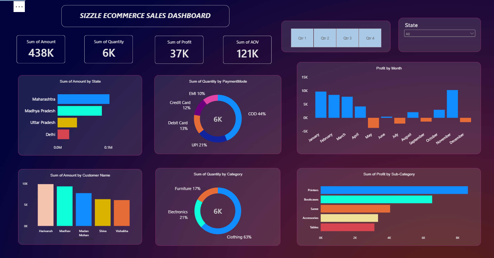

# Ecommerce Sales Dashboard (Power BI)

An interactive sales dashboard built in Power BI as my first data visualization project.

## Tools Used
- Power BI Desktop
- Power Query (data cleaning)
- Data modelling (Orders and Details tables)

## What I Did
- Cleaned the data in Power Query: promoted headers and fixed data types
- Fixed the Order Date format (day/month/year) using the correct locale
- Built a one-to-many relationship between Orders and Details on Order ID
- Created KPI cards for Amount, Quantity, Profit and AOV
- Added charts for profit by month, amount by state, payment mode, category and sub-category
- Added slicers for quarter and state

## Key Insights
- Total sales amount for the year is about 438K.
- Printers is the most profitable sub-category, followed by Bookcases and Saree.
- November is the most profitable month, and January to March also perform strongly.
- May, September and December show negative profit, so these months need a closer look.
- Cash on Delivery (COD) is the most used payment mode at about 44% of quantity, followed by UPI at about 21%.
- Clothing accounts for about 63% of quantity sold, well ahead of Electronics and Furniture.

## About
Built as a hands-on learning project while learning Power BI and data modelling.
